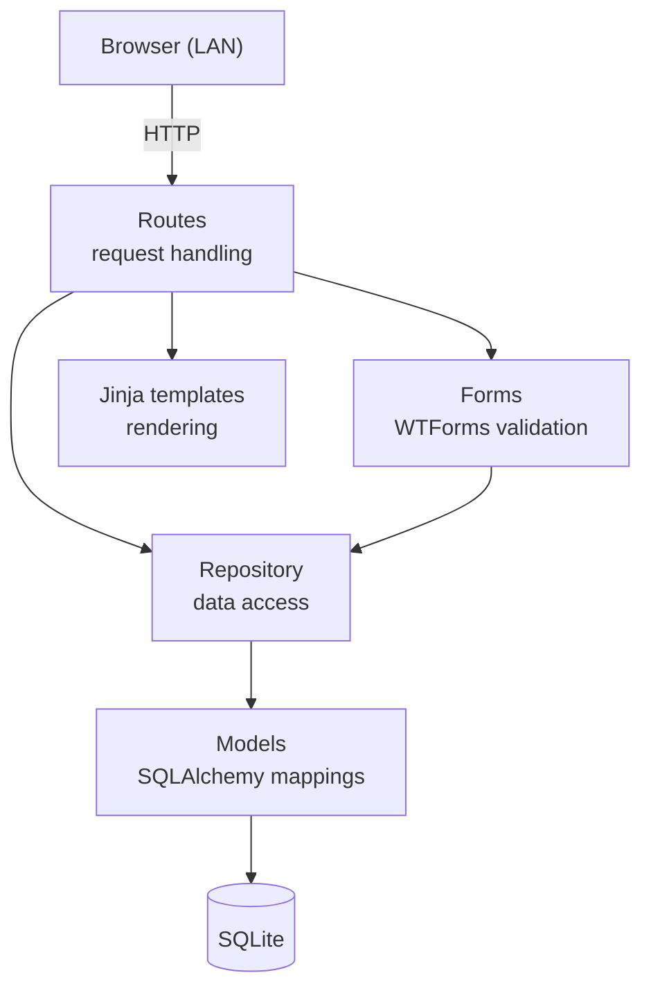

# Office Manager

**A single web app for the office work a small business actually has to do — invoicing, quoting, payroll support, corporate records, and document management — without the enterprise weight of the tools that normally bundle it.**

> **Status:** early development. Invoice search is working; invoice creation is in progress. Not yet usable as a daily driver. See [Roadmap](#roadmap).

---

## Why this exists

A five-person business does not need a five-department ERP.

The dominant small-business software category is built for companies with an IT department, a controller, and a dedicated person to configure it. Those products are priced per seat, per module, and per year, and they earn that price by shipping features most small businesses will never open: multi-entity consolidation, approval chains, audit trails, custom report builders, integration marketplaces.

For a small business, that complexity isn't free. It costs money in subscriptions, and it costs more in the thing that actually matters — **time spent managing the software instead of the business.** When one person handles AP, AR, payroll, and compliance for three companies, a tool that requires training to configure is not an asset.

This project takes the opposite approach: consolidate the *basic* functions of a small-business office into one tool, and leave everything else out on purpose.

**Design principle:** every feature has to earn its place by removing work from the person using it. When in doubt, we ship the simpler version.

## What it does

One web app, one login-free dashboard, where a single office manager can:

- **Manage documents by tag** — invoices, contracts, proposals and estimates, employee records, contractor records, vehicle files, payments and bills — instead of rebuilding the same folder tree in four different programs.
- **Handle invoicing and quoting** — customers, items, line-item entry, and computed totals, backed by a real relational schema rather than a spreadsheet.
- **Keep corporate records in one place** — the filings, documents, and reference material that otherwise live in a filing cabinet and someone's memory.
- **See what needs doing** — a task and reminder dashboard so payment dates and filings don't depend on recall.

## Scope

### Implemented
- [x] Layered application structure separating routes, forms, and data access
- [x] SQLAlchemy repository layer as the single point of database access
- [x] Customer, item, and invoice domain models, including invoice line items
- [x] Invoice search with server-side validated search form
- [x] WTForms + Flask-WTF integration with CSRF protection
- [x] Jinja templates with Bootstrap-based layout
- [x] Customer and item autocomplete via HTML datalists bound to live database records

### In progress
- [ ] Invoice creation — line items, quantities, and persisted invoice totals
- [ ] Item default values populated client-side on datalist selection
- [ ] New-customer entry flow

### Planned (V1)
- [ ] Tagged file management with hierarchical folders
- [ ] Department-oriented data organization (AR, AP, HR, Vehicles)
- [ ] Dashboard navigation: Company → Department → Tag, never more than three levels deep
- [ ] Task list with priority and per-user state
- [ ] In-browser reminders for payments and deadlines

### Explicitly out of scope for V1
Naming what we're *not* building is part of the design:

- Cloud hosting and remote access (LAN-only to start)
- User accounts and multi-user editing
- Notifications outside the browser
- Vehicle GPS, insurance tracking, photo galleries
- A reactive SPA frontend — server-rendered templates first
- Analytics, report builders, integrations, mobile apps

## Tech stack

| Layer | Choice | Why |
|---|---|---|
| Language | Python 3.12+ | — |
| Web framework | Flask 3.1+ | Small surface area; the app is CRUD and templates |
| Templating | Jinja2 | Server-rendered pages, no build step |
| Forms & validation | Flask-WTF / WTForms | Validation lives in Python, not scattered across JS |
| ORM | SQLAlchemy 2.0 | Explicit models and a real schema |
| Database | SQLite | Single-office deployment; zero administration |
| Styling | Bootstrap | Responsive layout without writing a design system |
| Dependency & env management | uv | Reproducible installs from `pyproject.toml` + `uv.lock` |
| Config | python-dotenv | Secrets out of source control |
| Testing / linting | pytest, ruff | — |

## Architecture

Requests move through four layers, and each one has exactly one job:



**Rules this codebase follows:**

- **Routes never touch the ORM directly.** All database access goes through the repository layer, so query logic lives in one place and can be tested without an HTTP request.
- **Forms own validation.** Anything submitted by a user is validated by a WTForms class before it reaches the repository.
- **The engine is created by the repository, not by the package.** This resolves a circular import between the database module and package initialization.
- **Configuration comes from the environment.** No credentials or paths hardcoded in source.

## Getting started

Requires Python 3.12+ and [uv](https://docs.astral.sh/uv/).

```bash
git clone https://github.com/srservices9/bootp1.git
cd bootp1
uv sync
```

Create your environment file:

```bash
cp .env.example .env
```

Then fill in `.env`:

```ini
SECRET_KEY=your-secret-key-here
DATABASE_URL=sqlite:///path/to/your/database.db
```

Run the app:

```bash
uv run bootp1
```

Then open `http://127.0.0.1:5000`.

### Tests and linting

```bash
uv run pytest
uv run ruff check .
```

## Project structure

```
bootp1/
├── docs/
│   ├── DIAGRAMS.md          # architecture and schema diagrams
│   └── project-brief        # original scope definition
├── src/
│   ├── bootp1/
│   │   ├── forms/           # WTForms classes, one module per route
│   │   ├── models/          # SQLAlchemy models
│   │   ├── routes/          # Flask blueprints / view functions
│   │   ├── templates/       # Jinja templates
│   │   ├── config.py        # environment-driven configuration
│   │   ├── main.py          # application entry point
│   │   └── __init__.py      # app factory
│   └── tests/
│       └── models/          # model and repository tests
├── .env.example
├── pyproject.toml
└── uv.lock
```

## Roadmap

| Milestone | Goal |
|---|---|
| **M1 — Invoicing** | Complete invoice creation with line items and totals; full customer CRUD |
| **M2 — Documents** | Tagged file upload, hierarchical folders, search |
| **M3 — Dashboard** | Company → Department → Tag navigation, tasks, reminders |
| **M4 — Hardening** | Test coverage on models and repository, deployment docs |

## Design decisions log

Short notes on choices worth explaining later.

- **SQLite over Postgres.** One office, one server, a handful of concurrent users. Postgres would add an installation and a backup routine for no benefit at this scale.
- **Server-rendered over SPA.** The workload is forms and tables. A React frontend would triple the surface area and buy nothing the office manager would notice.
- **Repository layer over raw ORM calls in routes.** Slightly more code now; means schema changes don't ripple into view functions.
- **Datalists over a JS autocomplete library.** Native HTML gets us typeahead with no dependency. If it stops being enough, we'll revisit.

## About

Built by [Sebastian Rodriguez](https://github.com/srservices9) — a programmer who spent six years as the office manager this app is designed for.

## License

Not yet licensed. [Add a license](https://choosealicense.com/) before accepting outside contributions.
