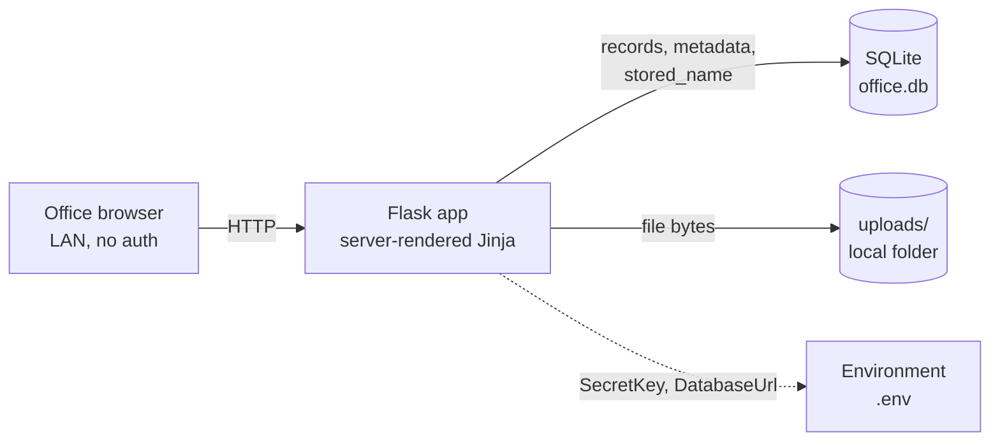
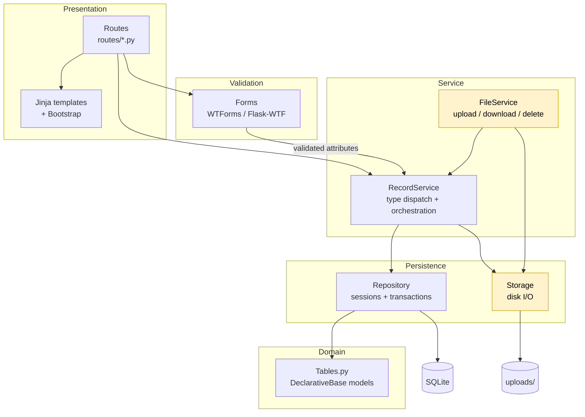
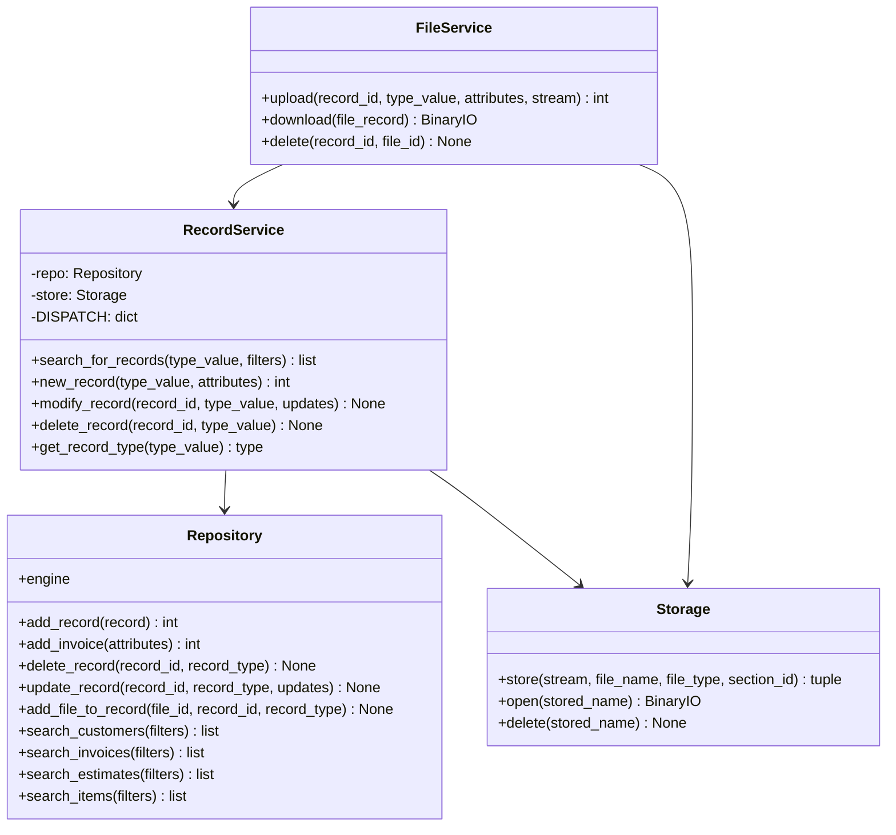
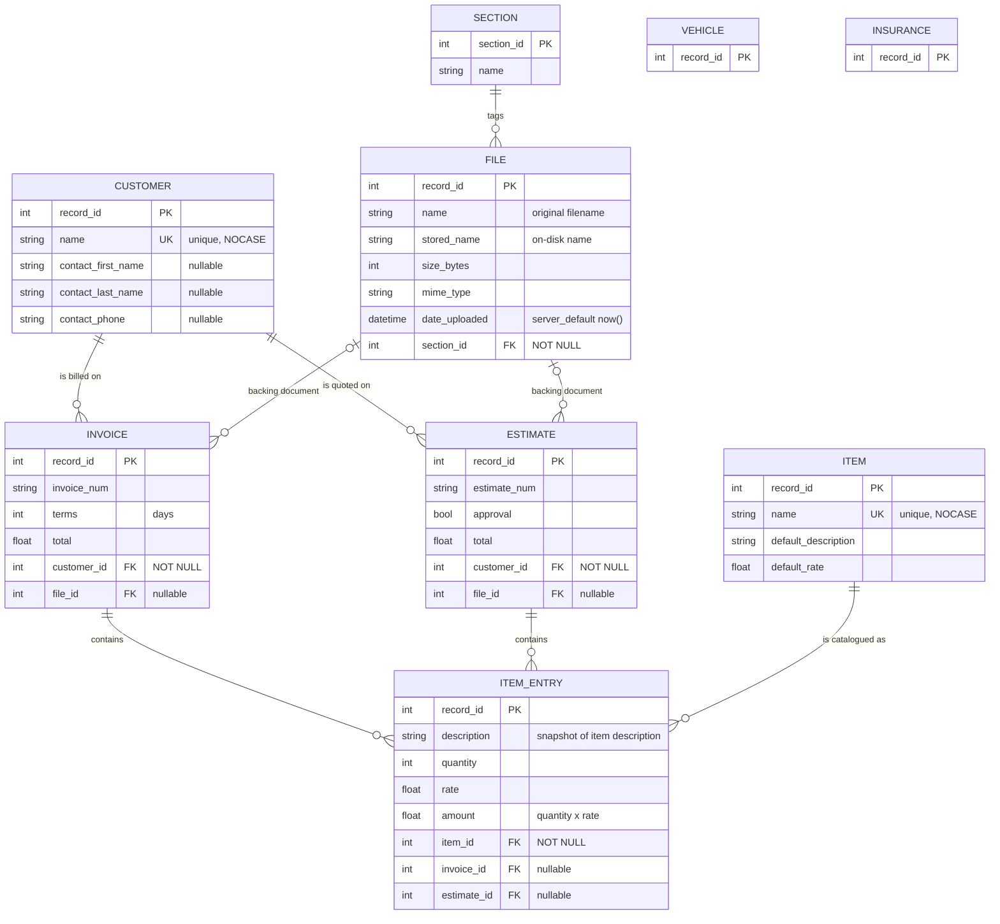
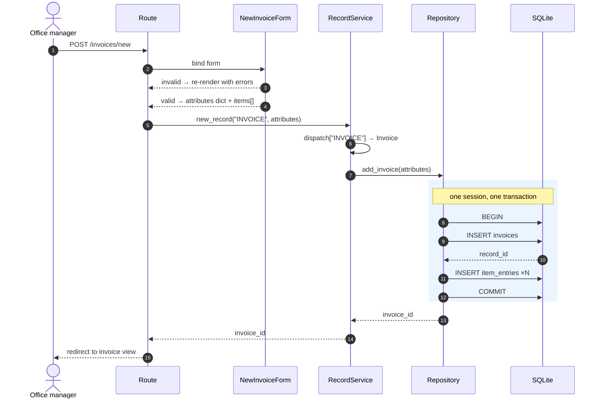
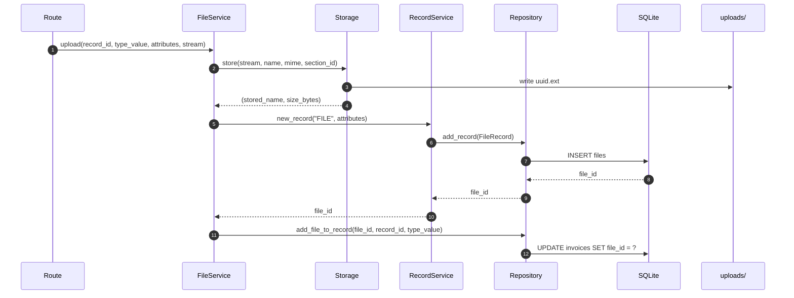

# Diagrams & Target Architecture

**This file describes the target state, not the current state.**

It is two things at once:

1. **A design reference** — how the app is meant to work: layers, relationships, write paths.
2. **A fix register** — the exact divergences between this design and the code, numbered `F-01`…`F-21`, with the code to write and the test that proves it's done.

When a diagram and `src/bootp1/models/Tables.py` disagree, this file wins and the code is wrong. Work §8 top to bottom; §9 gives the commit order and §10 gives the tests.

**Status:** `main` @ `897e630` · **Target:** after F-01…F-21 · **Last reviewed:** 2026-10-22

### Status legend

| Mark | Meaning |
|---|---|
| ✅ | Code matches this diagram |
| 🔶 | Implemented but incomplete or stubbed |
| ❌ | Code contradicts this diagram — see §8 |
| 🚧 | Not started, planned for a later milestone |

> **Warning:** three relationship declarations currently prevent SQLAlchemy's mapper configuration from completing (F-01, F-02, F-03). Until those are fixed, every database operation raises at mapper-configure time, not at query time. Fix those three first.

---

## 1. System context

Browser-facing on a LAN, one Flask process, one SQLite file, one uploads folder. File bytes on disk; metadata and everything else in the database.



SQLite and `uploads/` are colocated. **Backups must capture both** (F-21).

---

## 2. Target layered architecture

Dependencies point downward only. Each layer has exactly one job.



Yellow = target exists in code but is stubbed 🔶.

### Invariants

| # | Rule | Status |
|---|---|---|
| 1 | Routes never touch the ORM. All DB access goes through `RecordService` → `Repository`. | ✅ |
| 2 | Forms own validation. Nothing reaches the service without a WTForms class passing. | ✅ |
| 3 | The engine is built by `Repository`, never at module import scope. | ❌ F-17 |
| 4 | Configuration comes from `Config`, never hardcoded. | ❌ F-17 |
| 5 | Repository layers take dependencies by argument; services are constructed by the app factory. | ❌ F-17 |
| 6 | An invoice and its line items are written in **one** transaction. | ❌ F-10 |
| 7 | Failed writes raise. Nothing is caught and swallowed. | ❌ F-09 |
| 8 | `new_record()` returns the new `record_id`. | ❌ F-08 |
| 9 | Record type is a string at the boundary, mapped by a single dispatch table. | ✅ |

---

## 3. Target service layer



### Method contracts

| Method | Returns | Raises |
|---|---|---|
| `new_record` | new `record_id` (int) | `ValueError` unknown type, `LookupError` missing FK target |
| `modify_record` | `None` | `LookupError` if the row is gone |
| `delete_record` | `None` | `LookupError` if the row is gone |
| `add_invoice` | `invoice.record_id` | on any failure, whole transaction rolls back |
| `search_*` | `list` of models, or one model when `"match"` is passed | `ValueError` on match-with-multiple, `KeyError`-free on partial filters |

### Type dispatch (target)

```python
DISPATCH: dict[str, type[Base]] = {
    "CUSTOMER":  Customer,
    "INVOICE":   Invoice,
    "ESTIMATE":  Estimate,
    "VEHICLE":   Vehicle,
    "INSURANCE": Insurance,
    "ITEM":      Item,
    "FILE":      FileRecord,
    "SECTION":   SectionTag,
}
```

Adding `"SECTION"` is F-15; `search_for_records` must cover every key or return `[]` instead of `None` (F-16).

---

## 4. Target entity–relationship model



### Target relationship declarations

This is the authoritative block. Every line below is a fix against what's in `Tables.py` today.

```python
# Tables.py — target relationships

class Customer(Base):
    invoices:  Mapped[List["Invoice"]]  = relationship(back_populates="customer")
    estimates: Mapped[List["Estimate"]] = relationship(back_populates="customer")

class Invoice(Base):
    customer:     Mapped["Customer"] = relationship(back_populates="invoices", lazy="selectin")
    file:         Mapped[Optional["FileRecord"]] = relationship(back_populates="invoices")
    item_entries: Mapped[List["ItemEntry"]] = relationship(
        back_populates="invoice", cascade="all, delete-orphan")

class Estimate(Base):
    customer:     Mapped["Customer"] = relationship(back_populates="estimates", lazy="selectin")
    file:         Mapped[Optional["FileRecord"]] = relationship(back_populates="estimates")
    item_entries: Mapped[List["ItemEntry"]] = relationship(
        back_populates="estimate", cascade="all, delete-orphan")

class Item(Base):
    item_entries: Mapped[List["ItemEntry"]] = relationship(back_populates="item")

class ItemEntry(Base):
    invoice:  Mapped[Optional["Invoice"]]  = relationship(back_populates="item_entries")
    estimate: Mapped[Optional["Estimate"]] = relationship(back_populates="item_entries")
    item:     Mapped["Item"]               = relationship(back_populates="item_entries", lazy="selectin")

class FileRecord(Base):
    section:   Mapped["SectionTag"] = relationship(back_populates="files")
    invoices:  Mapped[List["Invoice"]]  = relationship(back_populates="file")
    estimates: Mapped[List["Estimate"]] = relationship(back_populates="file")

class SectionTag(Base):
    files: Mapped[List["FileRecord"]] = relationship(back_populates="section")
```

**The rule that prevents all three current bugs:** the side holding the `ForeignKey` is many-to-one and gets a **scalar** annotation; the other side gets `List[...]`. Check every relationship against the FK location before committing.

### Cardinality in plain English

| Relationship | Cardinality | Nullable | Collection accessor |
|---|---|---|---|
| Customer → Invoices | one-to-many | invoice requires customer | `customer.invoices` |
| Customer → Estimates | one-to-many | estimate requires customer | `customer.estimates` |
| Invoice → ItemEntries | one-to-many, cascade delete | entry may be orphaned only pre-flush | `invoice.item_entries` |
| Estimate → ItemEntries | one-to-many, cascade delete | same | `estimate.item_entries` |
| Item → ItemEntries | one-to-many | entry requires item | `item.item_entries` |
| Section → Files | one-to-many | file requires section | `section.files` |
| File → Invoices | one-to-many | optional | `file.invoices` |
| File → Estimates | one-to-many | optional | `file.estimates` |
| Vehicle, Insurance | none | PK only, placeholder | — |

### Modelling notes

- **`record_id` everywhere except `sections`.** Generic services call `record.record_id` without special-casing. `SectionTag.section_id` is the exception because it's reached via `FileRecord.section_id`.
- **`ITEM_ENTRY.description` is a snapshot**, copied from `Item.default_description` at entry time, so editing the catalogue never rewrites history.
- **`ITEM_ENTRY` carries both `invoice_id` and `estimate_id`, both nullable.** One shared line-item shape. Enforce exactly-one at the form layer, not the DB (SQLite CHECK constraints are awkward to migrate).
- **File bytes and metadata are deliberately split.** `name` is what the user sees; `stored_name` is what the disk sees. Never equal, never derivable from each other.
- **`CUSTOMER.name` / `ITEM.name` are `NOCASE` + unique**, which is what makes name-keyed autocomplete safe.

---

## 5. Target write path: creating an invoice

One transaction, invoice and line items together. Today this is N+1 transactions and the line items are never written (F-07, F-10).



```python
# DatabaseManager.py — target
def add_invoice(self, attributes: dict) -> int:
    items = attributes.pop("items", [])
    with Session(self.engine) as session, session.begin():
        invoice = Invoice(attributes)
        invoice.item_entries = [
            ItemEntry({k: v for k, v in i.items() if k != "invoice_id"})
            for i in items
        ]
        session.add(invoice)
        session.flush()          # assigns invoice.record_id, no commit yet
        return invoice.record_id # session.begin() commits on block exit
```

Two behaviours to preserve: `ItemEntry.amount` is computed once in `__init__`; `Invoice.total` is submitted by the form, and should be **validated against** `sum(e.amount)` before persisting (F-20).

---

## 6. Target write path: file upload



**Target:** `Storage.store()` returns `(stored_name, size_bytes)` and writes bytes under a UUID name with the extension preserved; `open()` returns a stream; `delete()` unlinks. `FileService.delete()` removes the row **and** the bytes, in that order, tolerating a missing file on disk.

---

## 7. Schema at a glance

| Table | Model | Rows represent | Target status |
|---|---|---|---|
| `customers` | `Customer` | Billing contacts | ✅ search, create |
| `invoices` | `Invoice` | Issued invoices | 🔶 create needs F-07/F-10 |
| `estimates` | `Estimate` | Quotes awaiting approval | 🚧 modelled, no UI |
| `items` | `Item` | Billable catalogue, default rate | ✅ search, create |
| `item_entries` | `ItemEntry` | Line items | 🔶 written only via F-07/F-10 |
| `files` | `FileRecord` | Document metadata | 🔶 storage stubbed |
| `sections` | `SectionTag` | Document tags (AR, AP, HR, Vehicles) | 🔶 no constructor (F-15) |
| `vehicles` | `Vehicle` | — | 🚧 placeholder |
| `insurances` | `Insurance` | — | 🚧 placeholder |

---

## 8. Fix register

Work top to bottom. Every fix has a `done-when` you can run.

### Track A — mapper configuration (do first; nothing works until these are done)

| ID | Sev | Where | Problem |
|---|---|---|---|
| F-01 | **BLOCKER** | `Tables.py:152` | `FileRecord.section` is `Mapped[List[SectionTag]]` but the FK is `files.section_id`. Inverted. |
| F-02 | **BLOCKER** | `Tables.py:153` | `FileRecord.invoice` is scalar `Mapped[Invoice]` while paired with `Invoice.file` (also scalar). One side must be `List`. |
| F-03 | **BLOCKER** | `Tables.py:100`, `:124` | `Item.item_entry` is scalar and `ItemEntry.item` is `List`. Both wrong for the same FK-direction reason. |

**F-01 / F-02 / F-03** — replace the whole relationship block with the target declarations in §4.

*Done when:* this passes.
```python
def test_mappers_configure():
    from sqlalchemy.orm import configure_mappers
    configure_mappers()   # raises today
```

---

### Track B — model constructors and integrity

| ID | Sev | Where | Problem |
|---|---|---|---|
| F-04 | HIGH | `Tables.py:46-51`, `:158-165` | `Estimate.__init__` and `FileRecord.__init__` require `record_id`, so a new row can't be constructed before it has an autogenerated PK. `FileRecord` also requires `date_uploaded` despite `server_default=func.now()`. |
| F-05 | MEDIUM | `Tables.py:42-44`, `:20` | `Estimate.file_id` column exists but the constructor drops it, and `Estimate` has no `file` relationship at all. |
| F-06 | HIGH | all FKs | No `cascade` / `ondelete`. Deleting an invoice orphans its `item_entries`; deleting a file row strands bytes in `uploads/`. |
| F-07 | MEDIUM | `DatabaseManager.py:10` | SQLite ignores `ON DELETE` unless `PRAGMA foreign_keys=ON` is set per connection. |
| F-08 | LOW | `Tables.py:167-170` | `is_previewable()` compares `mime_type == "pdf"`; real values are `application/pdf`. |
| F-09 | MEDIUM | `Tables.py:37-40` | `Invoice.total` is a stored column with no reconciliation against `SUM(item_entries.amount)`. Decide: derive it, or assert it at the service layer. |

**F-04** — make identity optional, everything else keyword-guarded:
```python
def __init__(self, attributes_dict) -> None:
    if "record_id" in attributes_dict:
        self.record_id = attributes_dict["record_id"]
    self.name = attributes_dict["name"]
    ...
    if "date_uploaded" in attributes_dict:
        self.date_uploaded = attributes_dict["date_uploaded"]
```
Do this for `Estimate`, `FileRecord`, `Vehicle`, `Insurance`, and add the missing `SectionTag.__init__` (F-15).

**F-06** — cascades plus DB-level enforcement:
```python
customer_id: Mapped[int] = mapped_column(ForeignKey("customers.record_id", ondelete="RESTRICT"))
file_id:     Mapped[Optional[int]] = mapped_column(ForeignKey("files.record_id", ondelete="SET NULL"))
item_id:     Mapped[int] = mapped_column(ForeignKey("items.record_id", ondelete="RESTRICT"))
section_id:  Mapped[int] = mapped_column(ForeignKey("sections.section_id", ondelete="RESTRICT"))
```
`ON DELETE SET NULL` for `file_id` is what makes "delete the file, keep the invoice" safe. **F-07:**
```python
from sqlalchemy import event

@event.listens_for(engine, "connect")
def _fk_pragma(dbapi_conn, _record):
    dbapi_conn.execute("PRAGMA foreign_keys=ON")
```

**F-08** — 
```python
_PREVIEWABLE = {"application/pdf", "image/png", "image/jpeg", "text/plain"}

def is_previewable(self) -> bool:
    return self.mime_type.split(";")[0].strip().lower() in _PREVIEWABLE
```

*Done when:* `test_delete_invoice_removes_entries` and `test_delete_file_nulls_fk` pass (§10).

---

### Track C — service correctness

| ID | Sev | Where | Problem |
|---|---|---|---|
| F-10 | **BLOCKER** | `RecordManager.py:25` | `if record is Invoice` compares an instance to a class. Always false, so line items are never created. |
| F-11 | HIGH | `RecordManager.py:22-34` | `new_record` returns `None` on every path, so `upload_file` passes `file_id=None` to `add_file_to_record`. |
| F-12 | HIGH | `RecordManager.py:33-61` | All four write methods wrap in `except: traceback.print_exc()`. Failures are printed and swallowed; the route reports success. |
| F-13 | HIGH | `DatabaseManager.py:56-71` | `update_record` uses `session.execute(Update(...))` then checks `session.is_modified(record)`. A Core update never dirties the ORM instance, so the check always fails, raising inside the `try` and rolling back. Every update is lost. |
| F-14 | HIGH | `DatabaseManager.py:46-49` | Same `is_modified` bug in `add_file_to_record`. |
| F-15 | MEDIUM | `RecordManager.py:63-80` | No `"SECTION"` case, and `SectionTag` has no `__init__`, so sections can't be created at all. |
| F-16 | MEDIUM | `RecordManager.py:10-18` | `search_for_records` has no branch for `ESTIMATE`/`VEHICLE`/`INSURANCE`/`FILE` and falls through returning `None`. |

**F-10 / F-11 / F-12** — target `new_record`:
```python
def new_record(self, type_value: str, record_attributes: dict) -> int:
    record_type = self.get_record_type(type_value)   # raises ValueError
    if record_type is Invoice:
        return self.repo.add_invoice(record_attributes)
    if record_type is FileRecord:
        return self.repo.add_record(FileRecord(record_attributes))
    return self.repo.add_record(record_type(record_attributes))
```
No `try/except` at this layer. If the caller needs a friendly message, the route catches and flashes — but the exception must reach it.

**F-13 / F-14** — use ORM attribute assignment, not Core `Update`:
```python
def update_record(self, record_id, record_type, updates):
    with Session(self.engine) as session, session.begin():
        record = session.get(record_type, record_id)
        if record is None:
            raise LookupError(f"{record_type.__name__} {record_id} not found")
        for key, value in updates.items():
            if not hasattr(record, key):
                raise AttributeError(f"{record_type.__name__} has no field {key!r}")
            setattr(record, key, value)
```
Unit of work handles the flush and the commit. Verification becomes "read the row back", not "ask the session whether it thinks it's dirty".

*Done when:* `test_update_persists`, `test_invoice_with_items_roundtrip`, and `test_create_missing_fk_raises` pass.

---

### Track D — query correctness

| ID | Sev | Where | Problem |
|---|---|---|---|
| F-17 | HIGH | `DatabaseManager.py:123`, `:158` | `if "min_total" and "max_total" in filters:` parses as `"min_total" and ("max_total" in filters)`. Truthy string, so it only tests `max_total`. |
| F-18 | HIGH | `DatabaseManager.py:126`, `:161` | Chained comparison `min <= Invoice.total <= max` evaluates as `(min <= col) and (col <= max)`. SQLAlchemy expressions define no `__bool__`, so if it were ever reached it would raise `TypeError`. |
| F-19 | MEDIUM | `DatabaseManager.py:123-130` | Combined effect: `{"max_total": 500}` alone raises `KeyError: 'min_total'`; both bounds raise; only `{"min_total": …}` works. |

**F-17 / F-18 / F-19** — one helper, used by both searches:
```python
def _apply_range(self, stmt, column, filters, low_key, high_key):
    low, high = filters.get(low_key), filters.get(high_key)
    if low is not None and high is not None and low > high:
        raise ValueError(f"{low_key} cannot exceed {high_key}")
    if low is not None:
        stmt = stmt.where(column >= low)
    if high is not None:
        stmt = stmt.where(column <= high)
    return stmt
```
Call as `stmt = self._apply_range(stmt, Invoice.total, filters, "min_total", "max_total")`. Separate `.where()` calls AND together correctly; `.between()` is equivalent but reads worse with optional bounds.

*Done when:* the parametrised range test in §10 passes for all four bound combinations, on both invoices and items.

---

### Track E — testability and configuration

| ID | Sev | Where | Problem |
|---|---|---|---|
| F-20 | HIGH | `RecordManager.py:6-7` | `REPO = Repository()` runs at import. `create_engine` + `create_all` fire on import, so any test that imports a model creates or touches the real `office.db`. |
| F-21 | MEDIUM | `DatabaseManager.py:10` | `echo=True` hardcoded: every statement printed, including in tests and production. |

**F-20 / F-21** — constructor injection:
```python
class Repository:
    def __init__(self, database_url: str, echo: bool = False, create: bool = True):
        self.engine = create_engine(database_url, echo=echo)
        if create:
            Base.metadata.create_all(self.engine)
```
```python
# RecordManager.py — no module-level singletons
class RecordService:
    def __init__(self, repo: Repository, store: Storage) -> None:
        self.repo, self.store = repo, store
```
Construct once in the app factory in `__init__.py` and attach to `app.extensions["records"]`. Add `Config.SQL_ECHO` (default `False`) alongside `SecretKey` / `DatabaseUrl`.

*Done when:* `pytest` passes with no `office.db` present in the working tree, and creates none.

---

### Track F — deferred (not blocking M1)

| ID | Item | Note |
|---|---|---|
| F-22 | `Storage.store/open/delete` are stubs | `store` returns `name + type` without writing. Move to M2 with §6 as the spec. |
| F-23 | `FileService.download/delete` are TODOs | Wire to `Storage` once F-22 lands. |
| F-24 | `Vehicle` / `Insurance` are PK-only | Fine as placeholders. Don't diagram them with relationships until they have columns. |
| F-25 | Wildcard imports (`from .Tables import *`) | Replace with explicit imports; it's why `relationship` shadowing stays invisible. |

---

## 9. Goalpost checklist

### Milestone 0 — "the app runs"

- [ ] F-01 mapper relationships
- [ ] F-02 `FileRecord`/`Invoice` cardinality
- [ ] F-03 `Item`/`ItemEntry` cardinality
- [ ] `configure_mappers()` passes
- [ ] F-20 repository injection
- [ ] F-21 `echo` from config

### Milestone 1 — "invoicing works"

- [ ] F-10 `new_record` dispatch
- [ ] F-11 `new_record` returns id
- [ ] F-12 no swallowed exceptions
- [ ] F-04 constructor signatures
- [ ] F-13/F-14 update via ORM
- [ ] Invoice + line items in one transaction
- [ ] F-09 total reconciled against line items
- [ ] `pytest` green

### Milestone 2 — "documents work"

- [ ] F-06/F-07 cascades + `PRAGMA foreign_keys`
- [ ] F-15 `SectionTag` constructor + dispatch
- [ ] F-22 `Storage` implementation
- [ ] F-08 `is_previewable`
- [ ] F-23 `FileService`

### Milestone 3 — "search is honest"

- [ ] F-17/F-18/F-19 range filters
- [ ] F-16 `search_for_records` covers all types
- [ ] F-05 `Estimate.file_id` + relationship

---

## 10. Acceptance tests

These map 1:1 to the register. Drop into `src/tests/`.

```python
# src/tests/conftest.py
import pytest
from sqlalchemy import event
from bootp1.models.DatabaseManager import Repository


@pytest.fixture
def repo(tmp_path):
    r = Repository(f"sqlite:///{tmp_path / 'test.db'}", echo=False)

    @event.listens_for(r.engine, "connect")
    def _fk_on(dbapi_conn, _record):          # F-07
        dbapi_conn.execute("PRAGMA foreign_keys=ON")

    return r
```

| Test | Proves | Needs |
|---|---|---|
| `test_mappers_configure` | F-01, F-02, F-03 | — |
| `test_create_and_read_customer` | F-04 | — |
| `test_invoice_with_items_roundtrip` | F-10, F-11, invoice transaction | M0 |
| `test_invoice_total_matches_entries` | F-09 | F-10 |
| `test_update_persists` | F-13 | M0 |
| `test_update_missing_record_raises` | F-12, `LookupError` contract | M0 |
| `test_delete_invoice_removes_entries` | F-06 | F-01…F-03 |
| `test_delete_file_nulls_invoice_fk` | F-06, `ondelete` | F-01…F-03, F-07 |
| `test_create_invoice_missing_customer_raises` | FK enforcement | F-07 |
| `test_range_filter[both/min_only/max_only/none]` × `invoices,items` | F-17, F-18, F-19 | — |
| `test_section_creatable` | F-15 | — |
| `test_search_returns_list_for_all_types` | F-16 | — |
| `test_is_previewable` | F-08 | — |

Key assertion shapes:

```python
def test_invoice_with_items_roundtrip(repo):
    cid = repo.add_record(Customer({"name": "Acme LLC"}))
    iid = repo.add_invoice({
        "invoice_num": "INV-001", "terms": 30, "total": 150.0, "customer_id": cid,
        "items": [
            {"item_id": 1, "description": "Mowing", "quantity": 2, "rate": 50.0},
            {"item_id": 2, "description": "Edging", "quantity": 1, "rate": 50.0},
        ],
    })
    inv = repo.search_invoices({"match": True, "invoice_num": "INV-001"})
    assert inv.record_id == iid
    assert len(inv.item_entries) == 2          # fails today: always 0
    assert sum(e.amount for e in inv.item_entries) == inv.total

@pytest.mark.parametrize("filters", [
    {"min_total": 100, "max_total": 200},
    {"min_total": 100},
    {"max_total": 200},
    {},
])
def test_range_filter(repo, filters):
    repo.search_invoices(filters)              # KeyError/TypeError today
```

---

## 11. Current → target divergence summary

| Area | Today | Target |
|---|---|---|
| Mapper config | raises on three pairs | clean `configure_mappers()` |
| Invoice creation | invoice saved, line items dropped | one transaction, both saved |
| Updates | always rolled back | unit-of-work flush |
| Range filters | `KeyError` or `TypeError` | four bound combinations work |
| Error handling | `print_exc()` and continue | exceptions propagate |
| Repository lifecycle | constructed on import | injected by app factory |
| File storage | stub returning a fake name | UUID on disk, size counted |
| Sections | unconstructable | taggable |

---

## 12. Maintenance

- Render: paste these ` ```mermaid ` blocks anywhere GitHub-flavoured. **Do not** omit the fence — the previous version of this file displayed as plain text.
- Trigger an update to this file when: `Tables.py` changes shape, a `Repository` method is added or its contract changes, or a `Config` key is added.
- When a fix lands: change its row in §8 to ~~struck-through~~ with the commit SHA, tick the §9 checkbox, and flip the matching diagram annotation from ❌ to ✅. Don't delete the row — the register is the audit trail.
- Keep the commit reference in the header current. A spec that silently lags the code is worse than no spec.

### Changelog

| Date | Change |
|---|---|
| 2026-10-22 | Reframed as target-state spec. Removed obsolete `FOLDER` hierarchy. Added fix register F-01…F-25 with severity, target code, and acceptance tests. Corrected relationship directions throughout; added invoice-creation and upload sequence diagrams. |
